<!-- ════════════════════════════════════════════════════════════════════
  Palette: Midnight #0b0d1f · Indigo #1a1f4d · Electric Blue #4f7cff
           Amber #ff9a3c · Gold #ffc46b · Ice #c9d1ff
  All artwork lives in /assets (animated SVGs + your portrait).
  To tweak colours or text, edit the SVG files directly.
═══════════════════════════════════════════════════════════════════════ -->

  
  

 

  
  

 

<!-- ═════════════════════ 01 · ABOUT ═════════════════════ -->



### Hey, I'm Dhvani

I'm an IT undergraduate interested in **cybersecurity and secure software engineering**. I also build **web and mobile apps, dashboards, and data-driven tools**—from the interface through to the APIs and systems behind them.

My work spans application security and threat modeling, social analytics, women's safety, voice scam detection, and habit intelligence. I enjoy making useful products that are clear to use and thoughtfully built.

<!-- ⚡ Add a fun fact here, e.g. "Fun fact: ..." -->

 

<!-- ═════════════════════ 02 · PROJECT ═════════════════════ -->


<a href="https://github.com/Dhvani30/NETRA">
  
</a>

<a href="https://github.com/Dhvani30/AegisVoice">
  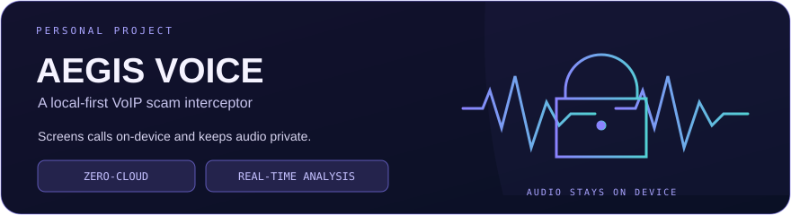
</a>

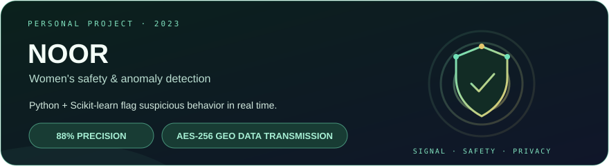

 

<!-- ═════════════════════ 03 · STACK ═════════════════════ -->


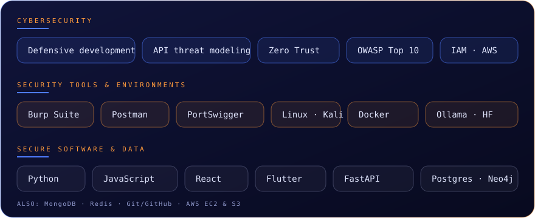

 

<!-- ═════════════════════ 04 · STATS ═════════════════════ -->


  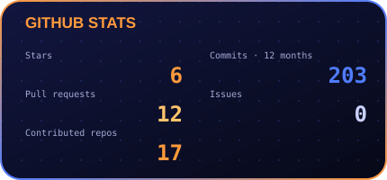
  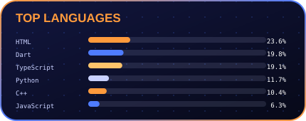
   
  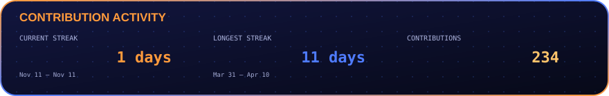
   
  

 

<!-- ═════════════════════ 05 · CONNECT ═════════════════════ -->


Open to collaborations, internships, and interesting problems across cybersecurity and product development. 
If you're building an app, dashboard, or privacy-minded tool, I'd love to hear about it.

