<!-- ════════════════════════════════════════════════════════════════════
  Palette: Midnight #0b0d1f · Indigo #1a1f4d · Electric Blue #4f7cff
           Amber #ff9a3c · Gold #ffc46b · Ice #c9d1ff
  All artwork lives in /assets (animated SVGs + your portrait).
  To tweak colours or text, edit the SVG files directly.
═══════════════════════════════════════════════════════════════════════ -->

  
  

 

  
  
  
  

 

<!-- ═════════════════════ 01 · ABOUT ═════════════════════ -->

### Hey, I'm Dhvani 👋

I'm an IT undergraduate focused on **cybersecurity and secure software engineering**. I work on defensive development, API threat modeling, threat detection, and privacy-first systems, with full-stack experience that helps me understand and secure applications end to end.

🛡️ &nbsp;Focused on application security, OWASP risks, zero-trust principles, and secure configuration 
🔭 &nbsp;Building **[NETRA](https://github.com/Dhvani30/NETRA)**, a platform for tracking how narratives spread across social networks 
🌱 &nbsp;Built **Safe Sprout** (personal project, 2023), a women's safety system using Python and Scikit-learn for real-time anomaly detection 
🎙️ &nbsp;Built **[Aegis Voice](https://github.com/Dhvani30/Aegis-Voice)**, a local-first VoIP scam detection tool 
📊 &nbsp;Built **[ZAP](https://github.com/Dhvani30/ZAP)**, an AI-powered habit intelligence platform 
🐧 &nbsp;Working with **Python, Linux/Kali, AWS, Burp Suite, and secure APIs**

<!-- ⚡ Add a fun fact here, e.g. "Fun fact: ..." -->

 

  

 

<!-- ═════════════════════ 02 · PROJECT ═════════════════════ -->

### More projects

| Project | Focus |
| --- | --- |
| **Safe Sprout** (2023) | Women's safety and real-time anomaly detection using Python and Scikit-learn; flags suspicious behavior with 88% precision and encrypts geospatial data in transit with AES-256 |
| [Aegis Voice](https://github.com/Dhvani30/Aegis-Voice) | Local-first VoIP scam interception with privacy-focused audio processing |
| [ZAP](https://github.com/Dhvani30/ZAP) | AI habit intelligence and anomaly detection |

 

<!-- ═════════════════════ 03 · STACK ═════════════════════ -->

 

<!-- ═════════════════════ 04 · STATS ═════════════════════ -->

  
  
   
  
   
  

 

<!-- ═════════════════════ 05 · CONNECT ═════════════════════ -->

Open to cybersecurity collaborations, internships, and interesting security problems. 
If you're working on application security, threat detection, or privacy-first systems, I'd love to hear about it.

